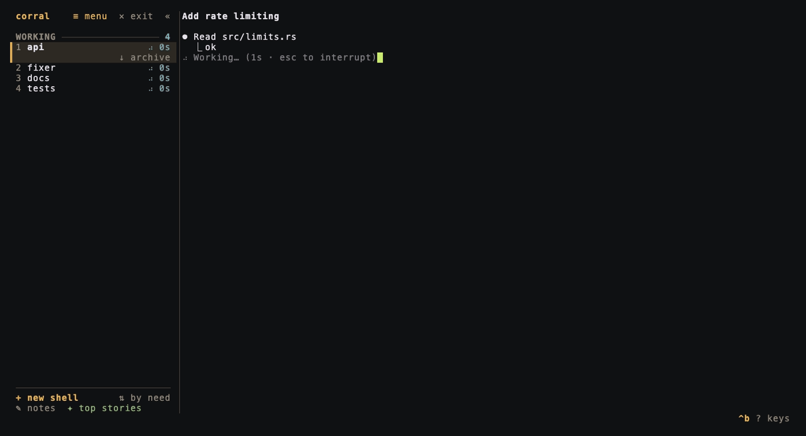

<p align="center">
  <picture>
    <source media="(prefers-color-scheme: dark)" srcset="docs/brand/logo-dark.svg">
    
  </picture>
</p>

# corral

A terminal runtime for coding agents. Run Claude Code, Codex, opencode and
friends side by side, see at a glance which one is waiting for you, and keep
them running when you close the laptop or lose SSH.

<p align="center">
  
</p>

## Why

Running several agents in separate terminal tabs breaks down quickly:

- **You miss agents that are blocked.** An agent asks for permission in a
  tab you're not looking at and sits idle for twenty minutes.
- **Closing the terminal kills the work.** Shutting the laptop lid or
  dropping an SSH connection ends every agent.

corral runs a small background server that owns every agent's terminal. The
UI is a client that attaches and detaches; the agents don't notice.

- **Who needs you, first.** The sidebar sorts agents by what they need:
  blocked or finished agents on top, then the ones working, then the quiet
  ones, each with how long it's been in that state. You also get a bell and a
  desktop notification.
- **Several agents on screen.** Show up to four agents side by side and type
  into whichever one you click.

## Install

On macOS or Linux, run:

```sh
curl -fsSL https://bottercode.github.io/corral/install.sh | sh
```

It downloads the latest release for your machine (Apple silicon or Intel,
x86_64 or ARM Linux), puts `corral` in `~/.cargo/bin` and adds that to your
`PATH` if needed. Then run `corral`.

### Download manually

Binaries are on the [releases page](https://github.com/bottercode/corral/releases):

| System | Asset |
|---|---|
| macOS Apple silicon | `corral-agents-aarch64-apple-darwin.tar.xz` |
| macOS Intel | `corral-agents-x86_64-apple-darwin.tar.xz` |
| Linux x86_64 | `corral-agents-x86_64-unknown-linux-gnu.tar.xz` |
| Linux aarch64 | `corral-agents-aarch64-unknown-linux-gnu.tar.xz` |

Unpack it and move `corral` somewhere on your `PATH`:

```sh
tar xf corral-agents-*.tar.xz
mv corral-agents-*/corral ~/.local/bin/
```

### From source

With Rust 1.90 or newer:

```sh
cargo install --git https://github.com/bottercode/corral
```

## Quick start

```sh
corral                      # open the UI (starts the server if needed)
```

corral opens a shell in the current directory. Start an agent in it the way
you normally would (`claude`, `codex`, `opencode`…); corral notices and tracks
it. When the agent quits you're back at the shell, in the same place.

Everything you type goes to the focused agent. corral's own commands are
**Ctrl-b, then a key** (the bottom line reminds you):

| Keys | Action |
|---|---|
| `^b n` | new shell, next to the focused agent's work |
| `^b j` / `^b k`, `^b ↑` / `^b ↓` | next / previous agent |
| `^b 1` … `^b 9` | jump to an agent |
| `^b b` | jump to the next blocked agent |
| `^b s` | show another agent alongside (up to four on screen) |
| `^b S` | take the focused agent off screen (it keeps running) |
| `^b o` | only the focused agent on screen; again to bring the others back |
| `^b h` / `^b l`, `^b Tab` | move between the agents on screen |
| `^b c` | collapse the sidebar to agent numbers, or expand it |
| `^b x` | close the agent's pane |
| `^b a` | archive the agent: end it but keep it to bring back later ([below](#archive)) |
| `^b A` | archived agents: bring one back, or forget it |
| `^b r` | rename it |
| `^b m` | menu: theme, sidebar order, notifications, agent hooks |
| `^b t` | top stories from Hacker News and lobste.rs ([below](#top-stories)) |
| `^b w` | notes, with a bit of Markdown ([below](#notes)) |
| `^b d` | detach (agents keep running) |
| `^b q` | exit: detach, or stop corral and every agent (also the **✕ exit** button) |
| `^b [` | scrollback (`k`/`j`, PgUp/PgDn, `g`/`G`, `q`) |
| `^b ?` | all the keys |
| `^b ^b` | send a literal `Ctrl-b` to the agent |

Click an agent on screen to type into it, or a sidebar row to bring that agent
into the focused spot. The sidebar has two halves, each scrolling with the
wheel when it's full (and following the focus until you do):

- **Spaces**, one per project, each with its branch (or folder) and a mark
  when an agent in it needs you (`◆ 2` blocked, `✓` done, a spinner while
  one works). Click one to go to its agent that most needs you. At the
  midway, **+ new** opens a shell and **≡ menu** (or `^b m`) changes the
  theme, the agents' order and notifications, and installs agent hooks;
  changes are saved to your config.
- **Agents**: those in the space you're in. **⇅ grouped** at the right end
  of their header switches between grouping them by what they need from you
  and listing them in the order they started.

Along the foot, **📝 notes** opens your notes, **📰 stories** the news, and
**📦 archive** the agents you've archived.

At the top:

- **«** collapses the sidebar to a narrow rail of agent numbers and state
  marks (`◆` blocked, `✓` done, a spinner while working), giving the room to
  your agents; **»** brings it back. `^b c` does the same.
- **✕ exit** asks whether to detach, leaving agents running, or stop corral
  and every agent.

Scroll the wheel for scrollback. **Drag in a pane to select text**: the
selection stays inside that pane, and letting go copies it to the
clipboard (through the terminal, which works over SSH too, and with
`pbcopy`, `wl-copy` or `xclip` on your own machine). Holding Shift (Option
in some terminals) still gives you the terminal's own selection.

Detach, close the terminal, and come back later (or from another machine over
SSH): run `corral` again and everything is where you left it.

### Archive

Done with an agent for now, but not with its work? Press `^b a` (or click
**↓ archive** next to the focused agent in the sidebar) to archive it.
corral ends its process but keeps its folder and its conversation. Archived agents survive restarts. `^b A` (or the
**📦 archive** button) lists them: Enter brings one back, resuming its
conversation, and `x` forgets it.

### After a reboot or a stop

If corral itself stops (a reboot, a crash, `corral kill-server` before an
update), the next `corral` offers to bring your panes back:

```
╭ welcome back ─────────────────────────────────────────────╮
│ corral stopped with 2 panes open. Bring them back?        │
│                                                           │
│  planner  api                 resumes its conversation    │
│  notes    corral              shell                       │
│                                                           │
│ Enter bring them back                                     │
│ n     start fresh                                         │
│ Esc   decide later (`corral restore`)                     │
╰───────────────────────────────────────────────────────────╯
```

- Agents pick up their conversation: `claude --resume <id>`, `codex resume
  <id>`, `opencode --continue`, with the flags they had. corral finds the
  session from the files the agent writes (and from its hook, with
  `corral integrate claude`). If it can't tell which conversation was whose
  (two Claudes in one folder without hooks), the agent asks.
- Names and projects are kept.
- Anything else comes back as a shell in the same folder. Old commands are
  never run again on their own.
- `corral restore` does the same from a script, `corral restore --discard`
  lets them go. The record lives in `~/.corral/sessions/`.

### Top stories

While your agents work, `^b t` (or **📰 stories** in the sidebar) shows the
front pages of Hacker News and lobste.rs in place of the agents, with the
sidebar still beside it:

```
  TOP STORIES    Hacker News   lobste.rs                      updated just now
  ────────────────────────────────────────────────────────────────────────────

  ▍  1  Upcoming Critical PHP Security Release                         php.net
  ▍     141 points · 87 comments · 18h · by pushcx · php security

     2  Unikernels in OCaml                                          uniker.nl
        44 points · 0 comments · 8h · by xvw · ml osdev
```

- `j`/`k` or the wheel scroll; `Enter` (or a click on the title) opens the
  story in your browser; `c` (or a click on the line under it) opens the
  comments.
- `Tab` switches between the two sites; `r` refreshes; `Esc` goes back to
  your agents. `^b` keys still work from the page, and clicking an agent in
  the sidebar goes straight to it.
- Agents behind the page don't count as seen: one that finishes while you
  read stays **done**, and you still get its notification.
- Nothing is fetched until you open the page. corral then asks the sites'
  public APIs directly (no key, no account, nothing else in between) and
  keeps each feed for five minutes.

### Notes

`^b w` (or **📝 notes** in the sidebar) opens a notepad in place of the agents,
with your notes down the left and the selected one beside them:

```
  NOTES   + new note                                                   2 notes
  ────────────────────────────────────────────────────────────────────────────

  ▍ Release checklist       │ # Release checklist
  ▍ now · Ship notes in th… │
    Groceries               │ Ship **notes** in the next *minor*:
    now · milk              │
                            │ • [✓] editor
                            │ • [ ] save to `~/.corral/notes`
                            │ ▎ quotes too
```

- `n` (or **+ new note**) starts a note; its first line is the title.
  `Enter` or a click opens one for editing, `Esc` goes back to the list, and
  `x` deletes the selected note (after a `y`).
- `s` (`^s` while editing, or **↳ send to …** at the top) pastes the note
  into the agent you were on and takes you there. Enter is left to you, so
  you can add to it before the agent acts on it.
- Notes are Markdown, drawn with their formatting as you type: `#` headings,
  `**bold**`, `*italic*`, `` `code` ``, `~~struck~~`, `-` and `1.` lists,
  `- [ ]` tasks, `>` quotes, `---` rules and fenced code. The marks stay in
  view, faintly, so what you see is what's in the file.
- Enter carries a list on to the next item (Enter on an empty item ends it),
  `Tab` / `Shift-Tab` nest and un-nest an item, and `^t` ticks a task, or
  turns the line into one.
- Each note is a file in `~/.corral/notes/`, saved a second after you stop
  typing, so you can grep them or open them in your editor; changes made
  there show up the next time the page opens.

### Pasted images

Agents read a pasted image straight from the clipboard, so normally all you
see is `[Image #1]`. In corral, `Ctrl-V` in an agent (or dropping an image
file on the terminal) also puts the image on a card at the top right of the
pane, until Enter sends the prompt; its **✕** puts it away. Ghostty and
kitty draw it sharp, iTerm2 and WezTerm too; other terminals (and tmux) get
it in coloured half blocks. On Linux the clipboard is read with `wl-paste`
or `xclip`. `image_previews = false` turns it off.

### From your phone

`corral web` serves a small web app that you add to your phone's home
screen. There's no app store, and nothing to pay or sign. It shows your agents
the way the sidebar does, with **Approve** and **Deny** on blocked ones (and
the bottom of their screen, so you can see what you're saying yes to). It can
send an agent a note, opens a full terminal on any agent, and sends a push
notification when one starts needing you.

```sh
corral web            # or: corral web --daemon
```

It prints a QR code. Scan it with your phone's camera to pair (the code works
once, for 10 minutes; `corral web pair` makes another).

The phone needs HTTPS to install the app and get notifications. The easy,
free way is [Tailscale](https://tailscale.com): install it on this machine and
the phone, then run `tailscale serve --bg 7777` once. `corral web` finds your
machine's Tailscale name and puts it in the QR code. Other HTTPS proxies work
too; pass their address with `--url`.

On iPhone, open the link in Safari, then Share → Add to Home Screen, and turn
on notifications from the app's menu (iOS 16.4 or later).

- It listens on `127.0.0.1` only. Listening anywhere else needs `--bind ADDR
  --expose`, and goes over plain HTTP.
- Each phone gets its own token (only its hash is stored, in
  `~/.corral/web/`). `corral web devices` lists them and
  `corral web revoke NAME` signs one out straight away.
- A terminal opened on the phone is sized to the phone, the way tmux sizes
  a window to its latest client. Typing in the TUI takes the pane back;
  the phone's Fit button takes it back again.

## Agent state

| State | Meaning |
|---|---|
| ◆ blocked | a permission prompt or question is on screen |
| ✓ done | it was working and stopped, and you haven't looked at it since |
| ⠋ working | output in the last moment, or a spinner / "esc to interrupt" on screen |
| idle | you've seen it, or it hasn't started anything |
| exited N | the process ended |

Blocked and done agents are listed under **NEEDS YOU**, working ones under
**WORKING**, the rest under **QUIET**. An agent counts as seen once it's on
screen.

corral recognises claude, codex, opencode, gemini, amp, cursor-agent, copilot,
pi, droid and grok from the pane's foreground process. It then reads their
prompts from the screen using
[data-driven rules](src/detect/rules.toml), plus a generic `(y/n)` / `[Y/n]`
rule for any program.

### Hooks (more accurate)

Screen heuristics can drift as agent UIs change. Agents that support hooks
can report their state directly:

```sh
corral integrate claude     # adds hooks to ~/.claude/settings.json
corral integrate codex      # sets `notify` in ~/.codex/config.toml
```

Both commands show the diff and ask before writing. They back up the
original file once, can be run again safely, and are undone with
`--uninstall`. The hooks only do anything inside corral panes (they check
`$CORRAL_PANE`), so agents started elsewhere are unaffected.

| Claude Code hook | Reports |
|---|---|
| Notification (permission prompts) | blocked |
| Stop | done |
| UserPromptSubmit, PreToolUse, PostToolUse | working |

A hook report wins over the heuristics until the next hook event. It also
gives way when it goes stale:
- a minute of further output, for any report
- typing an answer, for `blocked`
- 10 s without output, for `working`

Other tools can report the same way from inside a pane:
`corral report --state blocked|working|done|idle`.

### Notifications

When an agent you aren't looking at becomes blocked or done, every attached
client rings the bell and sends an OSC 9 desktop notification. iTerm2,
Ghostty, WezTerm and kitty show these; Terminal.app ignores them. Turn
notifications off with `notifications = false`.

## CLI

The CLI is also the API for scripts and for agents that drive other agents.
Read commands take `--json`. Panes can be given as `p3`, `3`, or a unique
name.

| Command | |
|---|---|
| `corral` / `corral attach [workspace]` | open the UI |
| `corral ls [--json]` | list panes |
| `corral new [--name N] [--cwd DIR] [--workspace W] [--json] -- <cmd…>` | start a pane (default: your shell) |
| `corral send <pane> <text> [--enter]` | type into a pane |
| `corral read <pane> [--lines N] [--scrollback] [--json]` | print a pane's screen as text |
| `corral wait <pane> --state blocked\|done\|idle\|working\|exited [--timeout S]` | wait for a state (exit code 2 on timeout) |
| `corral kill <pane>` | close a pane |
| `corral rename <pane> <name>` | rename |
| `corral report --state S [--pane P]` | report state (hooks use this) |
| `corral integrate claude\|codex [--uninstall] [--yes]` | install agent hooks |
| `corral server [--daemon]`, `corral kill-server` | run / stop the server (stopping ends every agent; the next start offers to bring them back) |
| `corral restore [--discard]` | bring back the panes from before corral stopped, or let them go |
| `corral web [--port P] [--url URL] [--daemon]` | serve the phone app (see [From your phone](#from-your-phone)) |
| `corral web pair\|devices\|revoke NAME\|stop` | pair another phone, list or unpair phones, stop the daemon |
| `corral debug dump <pane> [-o FILE]` | save a pane's screen as replayable bytes (for rule fixtures) |

Example: run an agent unattended and collect its answer.

```sh
p=$(corral new -- claude)
corral send "$p" "add input validation to the signup form" --enter
corral wait "$p" --state blocked --timeout 600 && corral read "$p" --lines 30
```

Each pane gets these environment variables:
- `CORRAL_PANE`: the pane's id
- `CORRAL_SOCKET`: the socket of the server it belongs to
- `CORRAL_BIN`: the corral binary

## Configuration

`~/.config/corral/config.toml` (all optional):

```toml
prefix = "C-b"                         # C-a … C-z or C-space
default_command = ""                   # run in each new shell, e.g. "claude"; you get the shell back when it exits
notifications = true
sidebar_width = 30
sidebar_collapsed = false              # just the agent numbers (« / ^b c)
theme = "ranch"                        # ranch, ink or terminal
sidebar_order = "need"                 # need (grouped) or flat (in order)
update_check = true                    # once a day, a toast when a newer corral is out
image_previews = true                  # show images pasted into an agent
```

Themes:

- **ranch** (default): warm field colours. Hay for corral's own marks, rust
  for blocked agents, sage for finished work, creek blue for work in
  progress, heather for branches. It draws on your terminal's background.
- **ink**: greys, with one amber signal kept for agents that need you.
- **terminal**: your terminal's own 16 colours, so it matches whatever
  palette you already use.

Environment variables:

| Variable | Default |
|---|---|
| `CORRAL_SOCKET` | `$TMPDIR/corral-$UID/default.sock` |
| `CORRAL_HOME` | `~/.corral` (logs, sessions) |
| `CORRAL_CONFIG` | the config file path above |
| `CORRAL_LOG` | log filter, e.g. `debug` |

The server logs to `~/.corral/log/server.log`.

## How it works

```
corral (UI) ─────────┐
corral ls/send/read ─┼── Unix socket ($TMPDIR/corral-$UID/default.sock, 0700)
agent hooks (report) ┘          │
                         corral server (background, own session)
                         └─ pane = PTY + child process + vt100 emulator (10k lines scrollback)
                                   + state detector
```

- The server owns every PTY, so agents survive clients coming and going.
- Each pane's output feeds a terminal emulator (vt100) on the server.
- A client tells the server which agents it has on screen and at what size.
  For each one it gets a snapshot (scrollback included) and then the live
  byte stream, rendered with Ratatui and tui-term.
- Each PTY's size follows whichever client used it most recently, like tmux's
  `latest` policy.
- Keystrokes pass through to the pane untouched, apart from the prefix key,
  mouse events and bracketed pastes (which pass through whole).
- The server answers terminal queries (cursor position, device attributes),
  so programs that ask the terminal about itself start normally.
- Messages are MessagePack in length-delimited frames, with a strict
  protocol-version handshake.

## Compared to

**tmux / screen** keep processes alive and attachable too, but know nothing
about agents. You have to check each window for blocked prompts yourself.

**[Herdr](https://herdr.dev)** is the established tool in this space and the
inspiration for corral's server design: a server that owns the terminals,
attachable clients, agent state detection and a CLI API. It is far more
mature, with features corral doesn't have, such as tabs, plugins, session
restore after a reboot and access from other machines. corral focuses on the
loop of running agents in parallel and seeing which one needs you:

| | Herdr | corral |
|---|---|---|
| Sidebar | workspaces and agents | agents sorted by what they need from you, with waiting timers |

## Limitations (v0.1)

- macOS and Linux only.
- At most four agents on screen at once, in fixed layouts (no free-form
  splits or tabs).
- Agents don't keep running through a reboot or `corral kill-server`; they
  come back afterwards (resuming their conversation), but a command an agent
  was in the middle of isn't finished.
- Programs inside panes don't receive mouse events; the wheel scrolls
  corral's scrollback instead.

## Development

```sh
cargo fmt --check && cargo clippy --all-targets -- -D warnings && cargo test
cargo test --test tui -- --ignored --nocapture   # renders a real `claude` pane (needs claude)
```

The integration tests run the real binary as a server on a private socket,
and drive the TUI inside a PTY. To look at the UI from a script, the `drive`
example runs any command in a PTY and prints its screen:

```sh
cargo run --example drive -- 120x32 'wait:corral' 'type:\x02?' 'wait:help' dump -- corral
```

## License

MIT © 2026 bottercode
